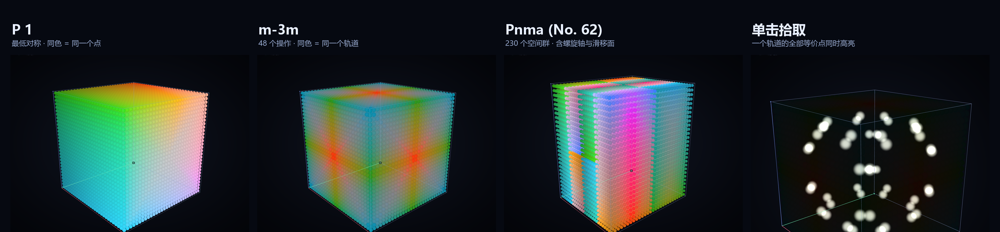
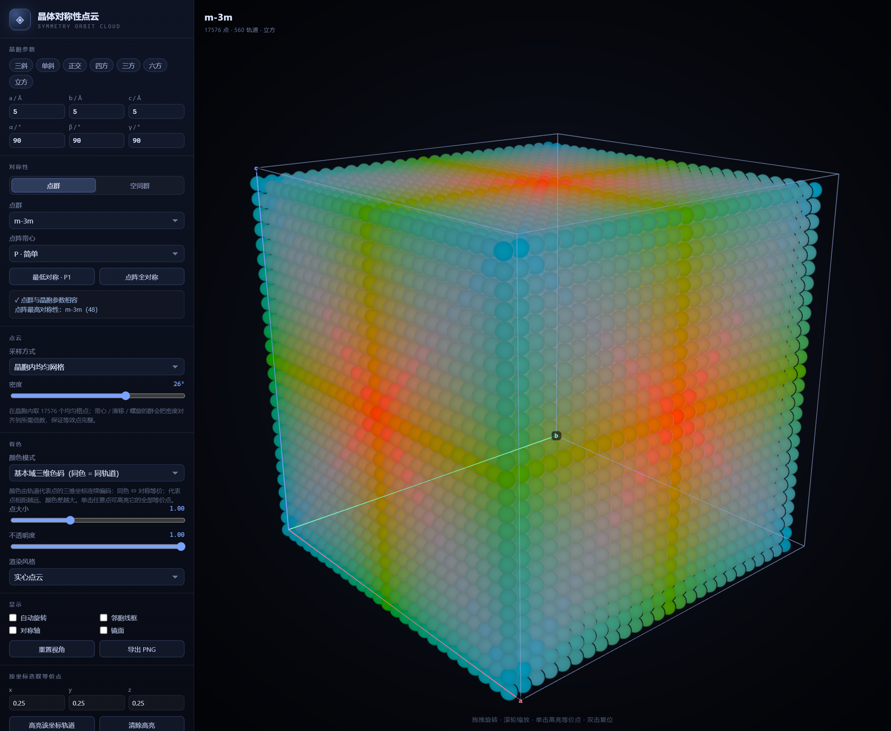
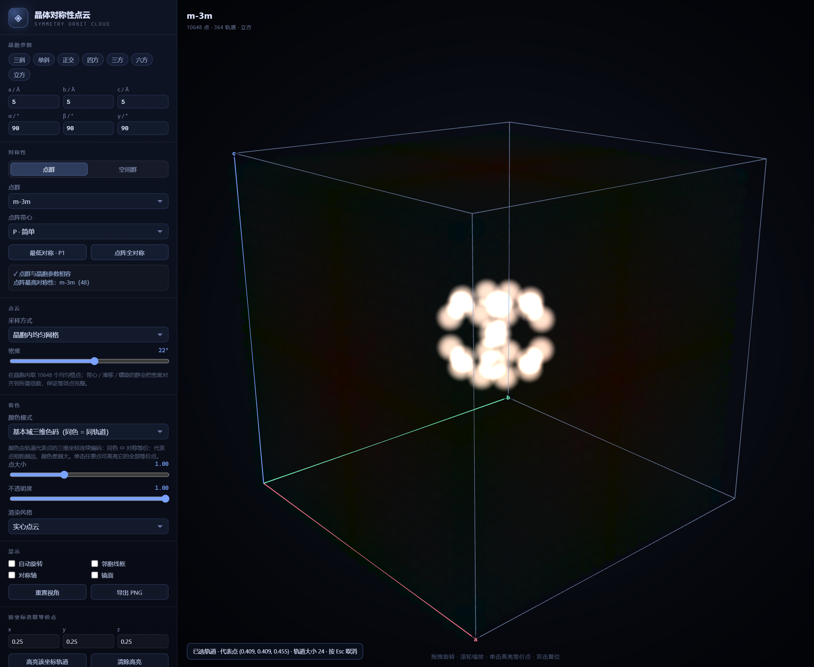
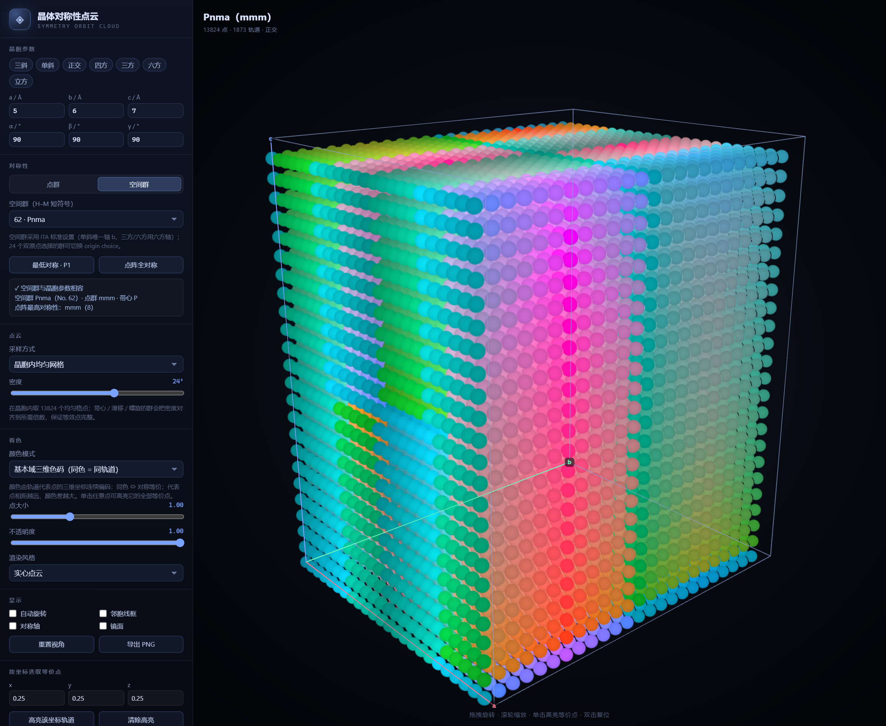
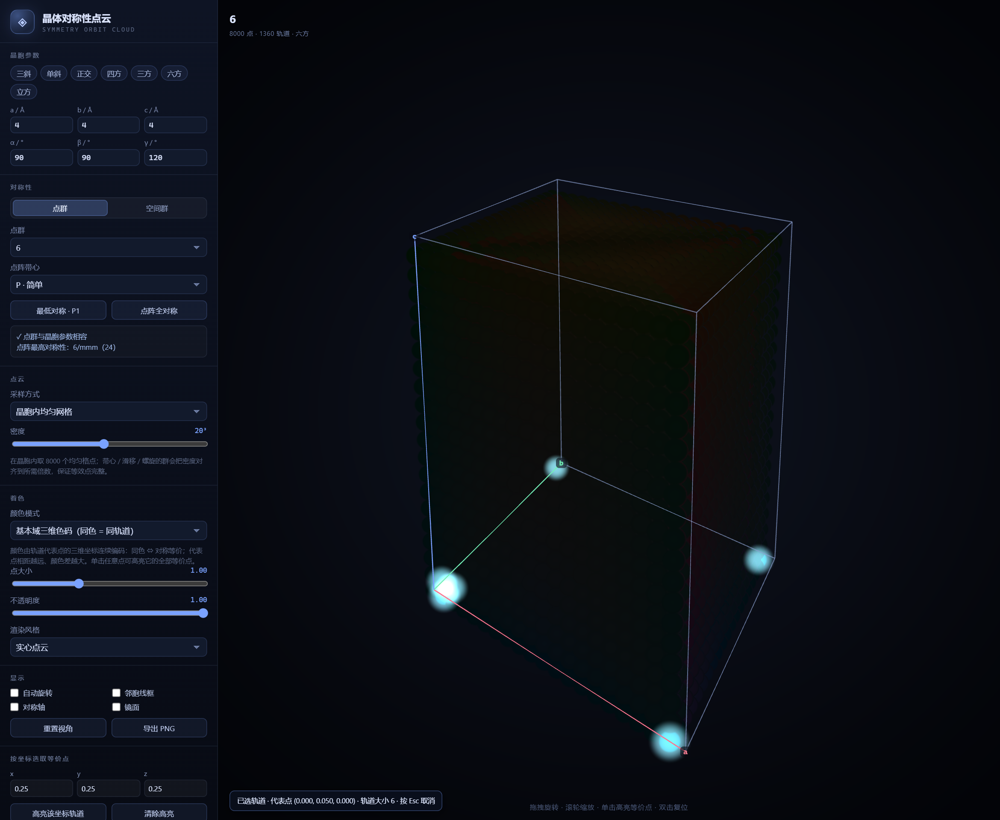
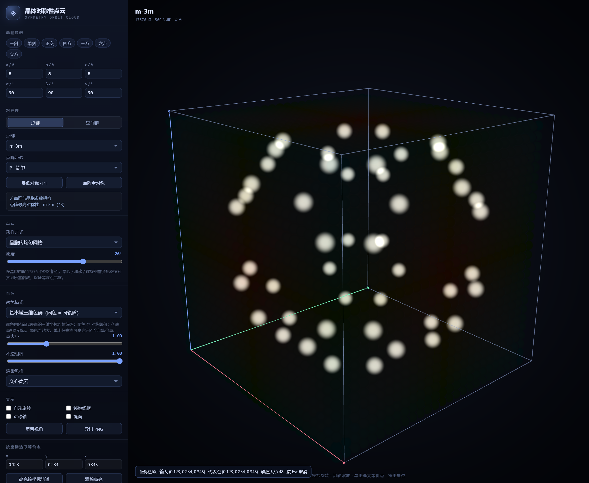

# 晶体对称性点云 · Symmetry Orbit Cloud

输入晶胞参数和对称性（点群 + 点阵带心），在晶胞里生成一团点云，
**把「由对称性判定为等价」的点染成同色，把不等价的点染成不同色**，
并且让颜色差随「代表点距离」单调增大 —— 用颜色直观地看见晶体学对称性。

纯静态网页：双击 `index.html` 即可运行，零依赖、无外链、无需联网。



- 左：点群 `1`（最低对称），每个点都是独立轨道，颜色随位置连续变化。
- 中：同一个晶胞换成点群 `m-3m`（48 个对称操作），等价点被折叠成同一个颜色。
- 右：**单击任意点**，它的整个轨道（48 个等价点）会被高亮出来，一眼看到“哪些位置是等价的”。

---

## 快速开始

1. 双击打开 `index.html`（需要支持 WebGL 的浏览器，Edge / Chrome / Firefox 均可）。
2. 默认是 **立方晶胞 + 点群 1**，也就是「最低对称性」：17576 个采样点各自成为一个轨道，颜色按位置连续变化。
3. 点一下面板里的 **「点阵全对称」**，或把点群换成 `m-3m`，就能看到颜色按轨道简并成高度对称的图案。
4. **单击任意一个点** → 它的全部等价点会发光高亮，同时左下角显示轨道代表点和轨道大小；按 `Esc` 或双击取消。
5. 顶部晶系按钮（三斜 / 单斜 / 正交 / 四方 / 三方 / 六方 / 立方）会同时给出该晶系的示例晶胞和代表性点群。
6. 想用真实的**空间群**（例如 `Pnma`、`Cmcm`）时，把对称性来源切到 **「空间群」**，从 230 个 ITA 空间群里选择；含螺旋轴 / 滑移面的轨道会按真实空间群计算。

常用操作：

| 操作 | 效果 |
| --- | --- |
| 拖拽 | 旋转视角 |
| 滚轮 | 缩放 |
| 单击点云 | 高亮该点所在的整个轨道（等价点集） |
| 输入分数坐标 | 在「按坐标选取等价点」里输入 (x, y, z)，精确高亮整个轨道 |
| `Esc` / 双击 | 取消高亮 / 复位视角 |
| 「导出 PNG」 | 保存当前画面 |











---

## 功能一览

**晶胞参数**
- a / b / c / α / β / γ 六个参数，任意三斜晶胞都能画（会检查基矢是否共面）。
- 7 个晶系预设按钮。

**对称性**
- 32 个晶体学点群（按晶系分组）。
- 7 种点阵带心：`P` `A` `B` `C` `I` `F` `R`。
- 点群与晶胞参数**严格相容性检查**：不相容时给出原因，并可一键把晶胞参数对齐到该点群（例如 `4/mmm` 要求 a=b、三个 90°）。
- **自动识别点阵全对称**：直接枚举所有整数矩阵，找出这个晶胞（含带心）真正拥有的最高对称群，例如立方 → `m-3m`（48）、六方 → `6/mmm`（24）、`R` 带心的六方轴 → `-3m`（12）。

**空间群（230 个）**
- 支持 International Tables for Crystallography 的 230 个空间群（H–M 短符号，如 `Pnma`、`Cmcm`），按晶系分组选择。
- 24 个双原点选择的群可切换 `origin choice 1 / 2`。
- 选中空间群后自动推导点群与带心，并按**包含螺旋轴 / 滑移面平移的通用位置**计算轨道。
- 晶胞与空间群的标准设置不符时给出警告，并可一键把晶胞参数对齐到该空间群所需的晶系。

**点云**
- 晶胞内均匀网格（默认 26³ = 17576 点，滑块 6³ ~ 36³）：取**格点** k/n，并把 n 自动对齐到当前对称群平移分母的倍数，保证一个轨道的全部等价点都落在网格里。
- 晶胞内随机点（确定性伪随机，方便复现）：每个种子点的**完整轨道**会被展开并去重。
- 自定义分数坐标：每行一个种子点 `x y z`，按当前对称群（点群或空间群）展开成轨道，同一轨道的点同色 —— 「Wyckoff 位置」的直观版本。

**颜色（核心）**
- **「基本域三维色码」**（默认）：轨道代表点的三维坐标 → CIELAB 亮色子空间的三维连续映射。
  - 同一轨道 → 同一代表点 → **严格同色**；
  - 连续、单射，颜色差随代表点距离单调增大；
  - 亮度参与编码但 L* 有下限，所有颜色都在 sRGB 色域内，不会出现裁切和过暗的点。
- 「轨道离散色」：每个轨道一种颜色（黄金角分配色相），适合点数不多的自定义点集。
- 「按坐标三维色码」：不做对称化，用于对照观察对称折叠前后的差别。

**显示**
- 晶胞线框、邻胞线框、按重数着色的对称轴、半透明镜面、自动旋转（默认关闭，可在面板里打开）。
- 统计：点群、晶系、操作数、晶格最高对称、采样点数、不同轨道数、平均轨道大小、操作类型统计。
- 渲染风格：实心点云 / 加法发光。
- 单击高亮等价点（单独的发光层，不改变原有颜色身份）。
- **按分数坐标精确选取等价点**：输入 `(x, y, z)` 后按当前对称群展开完整轨道并高亮，自动对 1 取余；比鼠标点选精确。

**其他**
- 导出 PNG（`canvas.toDataURL`）。
- URL 参数，可复现固定画面（见下）。

---

## 原理

### 1. 晶胞、对称操作与轨道

晶胞由 6 个参数给出基矢矩阵 `B`（列向量为 a、b、c 的笛卡尔分量），度规张量 `G = Bᵀ B`。

点群表里不抄矩阵，而是给**几何生成元**（绕 `[hkl]` 转多少度 / 法向镜面 / 反演），
对每个生成元算

```
R_frac = B⁻¹ · R_cart · B
```

若它不是（容差内）整数矩阵，说明该操作不是此晶胞点阵的对称操作 → 点群与晶胞参数不符；
生成元闭包成群，再验证每个操作保持度规 `Rᵀ G R = G` 与群阶。

点 `p` 的轨道是

```
orbit(p) = { (R p + t) mod 1 : R ∈ 点群, t ∈ 带心平移 }
```

同一轨道的点就是晶体学上「等价」的点。

为了让点击高亮能显示**完整**轨道，采样必须与对称操作兼容：

- 网格取格点 `k/n`（而不是小格中心）：整数旋转矩阵会把格点映到格点；
- 带心 / 螺旋 / 滑移的分数平移要求 `n` 是其分母的倍数（`translationDenom`），程序会自动把密度对齐到该倍数，例如 R 带心取 `n` 为 3 的倍数、Fd-3m 取 4 的倍数；
- 随机采样则对每个种子点展开完整轨道后去重。

否则会出现「六方 6 点群每个轨道只采到 2 个点、点击却显示 6 重对称」这类矛盾。

### 1b. 空间群（230 个 ITA 标准设置）

空间群的每个对称操作是 `(R, t)`：`R` 是分数坐标下的整数旋转/反射矩阵，`t` 是分数平移（来自螺旋轴、滑移面和带心）。
空间群的**通用位置**就是所有 `(R, t)` 作用在一个一般点上得到的等价点集合。

- 数据来源：spglib 2.8.0 的 `get_symmetry_from_database()`，按 ITA 标准设置筛选后内嵌到 `spacegroups.js`；
  单斜取唯一轴 b，三方/六方取六方轴 H 设置，24 个群保留 origin choice 1/2 两个变体。
- 内置校验：每个群的操作数 = 点群阶 × 带心数；操作对乘法封闭；`R` 保持标准晶胞度规；已知 Wyckoff 特殊位置的多重度与 ITA 一致。
- 轨道计算与点群模式共用同一条 `(R, t)` 流水线，所以颜色、点击高亮、统计逻辑完全复用。

### 2. 基本域代表点

把轨道内所有点按 1e-6 量化后取字典序最小的那个，作为该轨道的**基本域代表点**：

```
canon(p) = argmin_{q ∈ orbit(p)} quantize(q)
```

同一轨道必然得到同一个代表点；不同轨道（一般位置）得到不同代表点。

### 3. 从代表点到颜色：三维色码

这是本次重做的核心。旧方案把代表点压成一个标量再送进循环彩虹色带，等价于把三维信息压成一条一维闭合曲线，因此会出现成片的「等色面」——很多位置差异很大的点颜色却完全相同。新方案直接在三维颜色空间里编码：

1. 代表点各坐标按**固定种子估计的基本域范围**归一化到 `[0,1]³`（与显示密度无关，改密度不会变色）。
2. 三个分量分别映射到颜色空间的三个自由度：

```
u  → CIELAB 亮度 L*（52 … 78，保证不过暗，同时拉宽亮度轴以降低各向异性）
(v,w) → 色度平面上的圆盘（Shirley–Chiu 方-圆同心映射）
        半径 → 色度 C（有限斜率曲线 0.5ρ + 0.5ρ²，中心处梯度有限，避免“色涡”），角度 → 色相方向
C 的上限按 L 和色相查 sRGB 色域边界表（预先二分算好），保证不裁切
```

3. 颜色 = `Lab(L, C·cosθ, C·sinθ)`：纯径向映射，低色度（趋近灰色）只会出现在基本域正中心的一点，其余位置都带有明确的色相。

映射的性质（均已在测试中验证）：

- **同轨道同色**：代表点相同 → 颜色严格相等；
- **单射**：不同代表点 → 不同颜色（8bit 量化后仍唯一）；
- **距离单调**：代表点距离越大，颜色差 ΔE 的中位数越大（0→1.3 距离档，ΔE 中位数 7 → 84）；
- **亮度下限**：所有颜色 L* ≥ 52，不会出现过暗的点（基本域正中心附近色度低、偏灰，但亮度仍在 52 以上）；
- **无中心爆彩**：色度曲线在 ρ=0 处导数有限，面对角线中段的单步色差峰值约 1.1（旧方案是 9.7），颜色沿对角线平滑变化；
- **不裁切**：所有颜色都在 sRGB 色域内。

因此「远处的两个点同色」只可能发生在**它们本来就对称等价**的时候——这正是我们想让人看到的信息。

### 4. 自动识别点阵全对称

枚举所有元素属于 `{-1, 0, 1}`、`|det| = 1` 的 3×3 整数矩阵（共 19683 个），
保留同时满足「保持度规」和「保持带心平移」的矩阵，
群阶即可判定：2 三斜 `-1`、4 单斜 `2/m`、8 正交 `mmm`、12 `-3m`（R 带心）、
16 四方 `4/mmm`、24 六方 `6/mmm`、48 立方 `m-3m`。

---

## URL 参数（可复现画面 / 分享）

```
index.html?pg=m-3m&a=5&b=5&c=5&n=30&autorot=0&ui=0
```

| 参数 | 含义 |
| --- | --- |
| `a` `b` `c` | 边长（Å） |
| `al` `be` `ga` | α β γ（度） |
| `pg` | 点群，如 `m-3m`、`6/mmm`；`__auto` 表示自动全对称 |
| `mode` | `space` 切换到空间群模式 |
| `sg` | 空间群编号 1–230（如 `62` 即 Pnma） |
| `orig` | 双原点群的变体下标：`0` = origin choice 1，`1` = origin choice 2 |
| `cent` | 带心 `P` `A` `B` `C` `I` `F` `R` |
| `n` | 网格密度 n（点数 n³） |
| `sample` | `grid` / `random` / `custom` |
| `color` | `canon` / `orbit` / `pos` |
| `blend` | `solid` / `glow` |
| `size` `alpha` | 点大小 / 不透明度 |
| `theta` `phi` `dist` | 相机方位角、仰角、距离 |
| `autorot` | `0` 关闭自动旋转 |
| `neighbors` `symaxes` `mirrors` | `1` 打开邻胞 / 对称轴 / 镜面 |
| `selx` `sely` `selz` | 按分数坐标高亮轨道（三个都给才生效） |
| `ui` | `0` 隐藏左侧面板（纯净截图） |

---

## 自检

```bash
# 对称性数学核心：155 项
node tests/test-symmetry.mjs

# 三维颜色码：7 项（色域、亮度上下限、单射、距离单调）
node tests/test-color.mjs

# 空间群数据：20 项（230 群操作数/闭包/度规、符号别名、Wyckoff 多重度、原点选择）
node tests/test-spacegroups.mjs

# 真实浏览器交互/渲染自检（需要本机 Edge，路径见脚本顶部）：63 项
node tests/cdp-check.mjs
```

`test-symmetry.mjs` 覆盖：32 个点群在各自晶系晶胞下的群阶/闭包/逆元/度规保持、
点群与晶胞不符时必须报错、7 种晶系/带心组合下自动全对称群阶与 H–M 记号、
「同轨道点必得同一基本域代表点」、轨道大小整除群阶×带心数、`m-3m` 特殊位置轨道大小、群元素分类计数。

`test-color.mjs` 覆盖：颜色全部在 sRGB 色域内、亮度 L* 上下限、同一输入同色、
不同输入 8bit 唯一、代表点距离 → 颜色差中位数单调增大。

`test-spacegroups.mjs` 覆盖：230 个空间群齐全、操作数 = 点群阶×带心数、乘法封闭、
旋转矩阵保持标准晶胞度规、短/全 H–M 符号别名解析、`Pnma`/`Cmcm`/`Pm-3m`/`Fm-3m`/`P6/mmm` 等已知
Wyckoff 特殊位置多重度、73 个共形群与「点群 × 带心」的一致性、24 个双原点群的两个变体差异。

`cdp-check.mjs` 通过 Chrome DevTools Protocol 驱动无头 Edge，验证预设、点群切换、带心、
**空间群模式（Pnma / Cmcm / Fd-3m 原点选择）**、**六方 6 点群轨道完整性回归**、**按分数坐标选取等价点（一般位置 / 特殊位置 / Esc / URL 参数 / 六方 6）**、不相容提示与一键对齐、自定义点云展开、
**「同一轨道颜色严格相同 / 不同轨道颜色清晰可辨 / 亮度不过暗」**、**单击高亮等价点与 Esc 取消**、
默认不自动旋转，并顺带重新生成 `shots/` 里的终版截图。

---

## 文件结构

```
crystal-symmetry-cloud/
├─ index.html          # 页面结构
├─ style.css           # 深色界面样式
├─ symmetry.js         # 对称性数学核心（32 点群、带心、轨道、全对称识别）
├─ spacegroups.js      # 230 个空间群（ITA 标准设置 + origin choice 变体，数据来自 spglib）
├─ color.js            # 三维色码（CIELAB 色域子空间 + 方-圆映射），浏览器/Node 通用
├─ render.js           # WebGL 渲染器（点云 / 高亮层 / 加粗线段 / 半透明面 / 轨道相机）
├─ app.js              # 采样、着色、统计、交互、点击高亮
├─ shots/              # 截图与三联对比图
├─ tests/
│  ├─ test-symmetry.mjs   # 数学核心单测
│  ├─ test-color.mjs      # 颜色码单测
│  ├─ test-spacegroups.mjs # 空间群数据单测
│  ├─ cdp-check.mjs       # 无头浏览器交互自检 + 截图
│  └─ make_compare.py     # 合成三联对比图（Pillow）
└─ README.md
```

---

## 已知边界与可扩展方向

- **对角线仍略强于坐标轴**：亮度轴与色度轴的色差跨度并不完全相同（沿 x 方向单步 ΔE≈1.1，沿 y≈3.6），因此对角线仍会比 x 方向略“彩”，但已经不再有中段突变；若追求严格各向同性，可改用 Lab 盒映射（颜色会明显变淡）。
- **基本域折痕**：颜色是「基本域代表点」的函数，在基本域边界（镜面/旋转轴处）代表点会跳变，因此颜色在那些面上会有折痕式跳变。这是「同色 ⇔ 同轨道 + 不同轨道不同色」的代价：若要处处连续，颜色就必须在对称操作下不变，那就无法区分不同轨道。
- **晶胞边界**：P1 模式下颜色按分数坐标编码，在晶胞边界处不连续（周期回绕）。这也是单射映射的代价（三维环面无法连续单射进 RGB 三维立方体）。
- **感知上限**：人眼在具体画面里能稳定区分的颜色约几百到几千种，所以颜色只能做到「数值上单射、感知上近似单射」；点非常密时仍会有相邻颜色难分的情况，这时可以降低密度或用单击高亮来精确确认等价关系。
- **特殊位置**：镜面/旋转轴上的点轨道更小（平均轨道大小会小于群阶），这是正常的晶体学现象，统计面板会给出平均值。
- **空间群目前只支持 ITA 标准设置**：`Pbnm`（Pnma 的另一种轴序）、`Ccmm` 等非标准设置暂不支持，需要时可加入基变换模块。
- 三方 R 群目前用**六方轴 H 设置**；菱面体 R 轴设置未支持。
- **对称元素叠加图目前按点群级绘制**（过胞心的旋转轴 / 镜面），螺旋轴与滑移面的真实位置与方向尚未单独绘制；轨道与颜色本身已按真实空间群计算。
- 后续可做：非标准 setting、空间群对称元素精确绘制、CIF 原子结构导入、按 Wyckoff 多重度分层着色、轨道大小直方图。

---

## 备注

- 所有计算都在浏览器本地完成，无任何外部请求。
- 点群生成元、带心约定、单斜唯一轴 b、六方轴 a=b γ=120° 等均采用晶体学常用标准设置。
- 空间群数据由 spglib（BSD 许可）的数据库导出并内嵌，已用本项目测试校验；不依赖运行时联网。
- 本项目代码以 **MIT 许可证**发布，详见 `LICENSE`。
